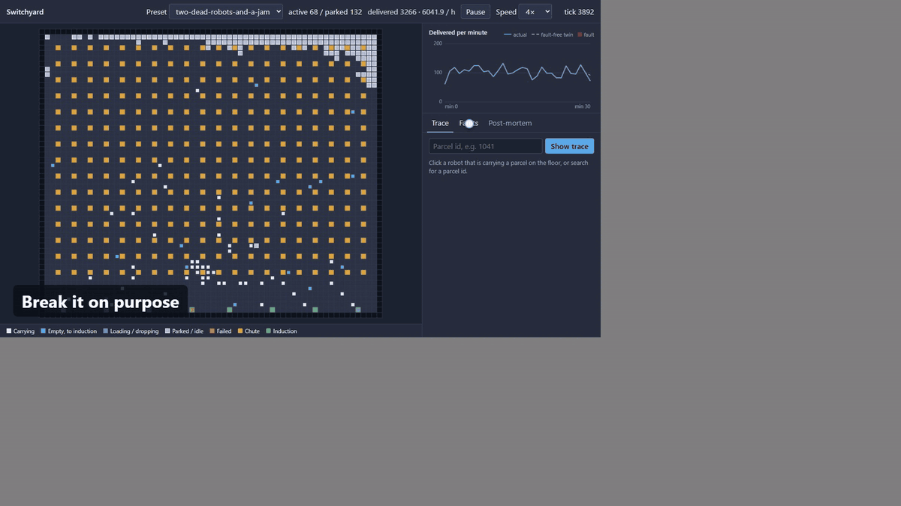
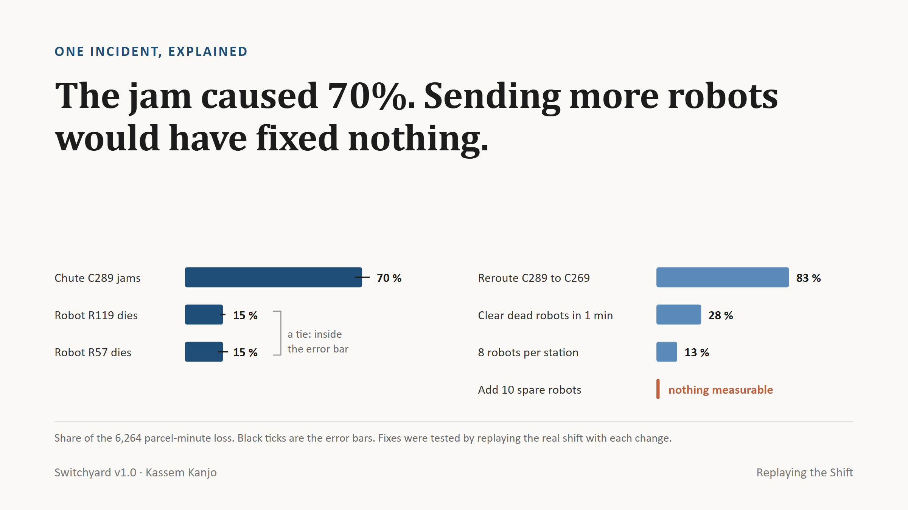
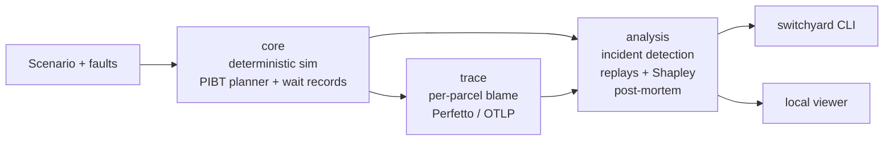
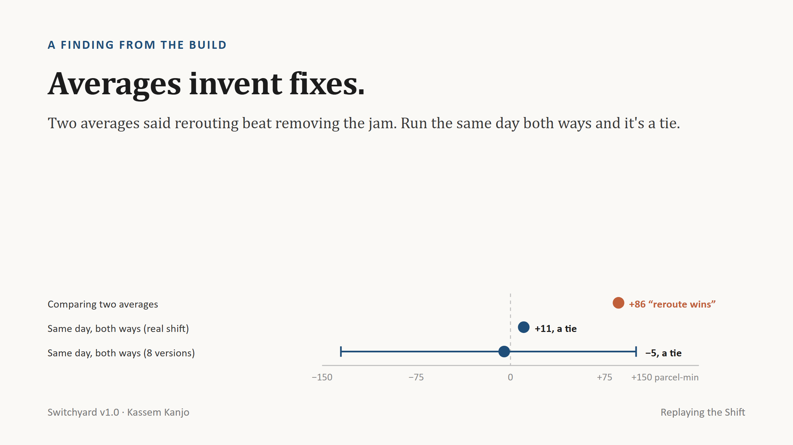

# Switchyard

**Find out what really broke a robotic sort floor, and what it cost.**

[](https://github.com/kassem-kanjo/switchyard/actions/workflows/ci.yml)
[](https://github.com/kassem-kanjo/switchyard/releases)
[](LICENSE)



When a parcel hub suddenly loses a third of its throughput, nobody can say for sure what caused it or how much each problem cost. Switchyard answers that by **replaying the shift**. It is a deterministic digital twin of a robot sort floor. It re-runs the same day with each problem removed, measures what comes back, and writes the incident post-mortem for you.

📄 **Paper:** [Replaying the Shift](docs/paper/switchyard-v1.pdf) (3 pages: how it works and what it found)

## What it does

- **Simulates** a sort floor robot by robot: 200 robots moving about 6,300 parcels an hour. Two hours of floor time take half a second on a laptop.
- **Traces every parcel.** Every robot that waits records why, so each late parcel shows where its time went and who held it up.
- **Breaks the floor on purpose:** dead robots, blocked aisles, jammed chutes, induction outages, volume surges.
- **Writes the post-mortem.** It finds the incident, splits the blame between causes, says which fix would have helped most, and proves each claim with a replay.

## One incident, explained

A chute jams and two robots die in the same minute. Throughput falls 47 %, and 110 parcels end up more than ten minutes late. Switchyard runs 96 replays in about five seconds:



The two robot failures are too close to rank, so the report calls them a tie instead of inventing an order. The usual reflex, sending more robots, would have done nothing, because the bottleneck was a chute. Clearing dead robots in one minute instead of five was worth 28 %, and it costs nothing.

## How it works

1. **A twin you can rewind.** The simulation is fully deterministic: the same inputs give exactly the same shift, bit for bit, on Windows, macOS, Linux and WebAssembly. So any difference between two runs comes from the one thing that changed.
2. **Replay the day without each problem.** For an incident, every combination of active faults is removed and the shift is replayed from the nearest checkpoint. Blame is split fairly with the Shapley value from game theory. The same replays show whether two faults overlapped or made each other worse, and test candidate fixes on the real day.
3. **Honest error bars.** A deterministic twin gives one exact answer, which looks precise but isn't: remove a fault and the robots take slightly different paths. So Switchyard replays several equally plausible versions of the day (one robot pauses for half a second at a moment that shouldn't matter) and reports the spread. Anything inside it is called a tie or "nothing measurable".



Design decisions are in [docs/adr](docs/adr/); the full design is in [docs/ARCHITECTURE.md](docs/ARCHITECTURE.md).

## Results

| Check | Result |
|---|---|
| Planted incidents with one clear cause | **24 / 24** named correctly |
| Hard incidents (near ties, overlapping and compounding faults), graded against an independent check | **44 / 48** main cause right; large interactions **24 / 24** |
| Speed | 2 h of a 200-robot floor in **0.5 s**; a full post-mortem (96 replays) in **≈ 5 s** |
| Determinism | identical state hash on Linux, Windows, macOS and WebAssembly, checked in CI |
| Tests | 255 Rust tests and 58 viewer tests, plus property tests for collisions, parcel conservation and trace integrity |

Small interactions, the ones under about 500 parcel-minutes, sit inside the floor's own noise. The report says so instead of guessing.



The most useful finding came from a bug. Two averages taken over different versions of the day made rerouting look better than removing the jam itself. Played the same day both ways, the two options tie. Any team that compares "days we did A" with "days we did B" can invent a fix this way. More findings: [docs/insights.md](docs/insights.md).

## Run it

**Download** a prebuilt `switchyard` binary for Windows, macOS or Linux from [Releases](https://github.com/kassem-kanjo/switchyard/releases), or build it from source with Rust (stable):

```bash
git clone https://github.com/kassem-kanjo/switchyard && cd switchyard
cargo build --release -p switchyard-cli
```

Then:

```bash
# Write a post-mortem for a chaos preset
switchyard postmortem --scenario two-dead-robots-and-a-jam --ticks 14400 --out report.md

# Simulate 2 hours of the 200-robot hub (1 tick = 0.5 s)
switchyard run --scenario medium --ticks 14400

# Inject your own faults and score the floor against its fault-free twin
switchyard chaos --scenario medium --ticks 14400 \
  --fault "robot-failure:robot=31,at=30m,for=20m" \
  --fault "chute-jam:chute=12,at=30m,for=15m"

# Export per-parcel traces and open them in https://ui.perfetto.dev
switchyard export --scenario medium --ticks 14400 --format perfetto --parcels late:p95 --out traces.json
```

Presets: `small`, `medium`, `large`, plus the chaos presets `aisle-7-blocked`, `peak-surge` and `two-dead-robots-and-a-jam`. Fault kinds: `robot-failure`, `aisle-block`, `chute-jam`, `induction-outage`, `volume-surge`, `scanner-drift`.

**Visual viewer.** To watch the floor, click a parcel's trace and read the post-mortem next to it, run the viewer locally. It needs Node 22:

```bash
cd viewer && npm ci && npm run dev
```

Full setup, including Windows: [docs/DEVELOPMENT.md](docs/DEVELOPMENT.md).

## How it was built, step by step

Each stage is one reviewed pull request, so the history reads as the roadmap:

| Stage | What it added |
|---|---|
| [Discovery](https://github.com/kassem-kanjo/switchyard/pull/1) | Research, product spec, architecture and decision records |
| [V0](https://github.com/kassem-kanjo/switchyard/pull/2) | Walking skeleton: the sim, the CLI and the viewer, end to end |
| [CP1](https://github.com/kassem-kanjo/switchyard/pull/3) | A floor that sorts: the guided PIBT planner and floor operations |
| [CP2](https://github.com/kassem-kanjo/switchyard/pull/4) | Parcel traces with blame chains, the fault catalog, chaos runs and a resilience score |
| [CP3](https://github.com/kassem-kanjo/switchyard/pull/5) | The post-mortem engine: incident detection, replays, Shapley blame, tested fixes |
| [V1 depth](https://github.com/kassem-kanjo/switchyard/pull/27), [hardening](https://github.com/kassem-kanjo/switchyard/pull/28) | Per-cause noise bands, the reroute check and the security review |
| [v1.0.0](https://github.com/kassem-kanjo/switchyard/releases/tag/v1.0.0) | The release, plus the [paper](https://github.com/kassem-kanjo/switchyard/pull/30) |

Each checkpoint went through an independent review; the reports are in [docs/checkpoints](docs/checkpoints/).

## Repo map

| Path | Contents |
|---|---|
| `crates/core` | Deterministic sim, PIBT planner, faults, causal wait records |
| `crates/trace` | Per-parcel traces, blame chains, exporters |
| `crates/analysis` | Incident detection, replays, Shapley attribution, post-mortem |
| `crates/cli` | The `switchyard` command |
| `crates/wasm`, `viewer/` | The local visual viewer |
| `scenarios/` | Floor presets and chaos presets |
| `docs/` | [Paper](docs/paper/switchyard-v1.pdf), [architecture](docs/ARCHITECTURE.md), [decision records](docs/adr/), [research](docs/research/), [checkpoint reviews](docs/checkpoints/), [insights](docs/insights.md) |

## Limits

The floor is simulated, not connected to a real hub yet. The next step is running the same replays on a copy of a real shift from a hub's logs. Small interactions between faults stay inside the noise. Exact Shapley values grow exponentially with the number of causes, so incidents with many causes at once will need sampled attribution.

## Built with AI

Built by Kassem Kanjo, with a team of AI agents: cheap models wrote well-specified code, stronger models reviewed it, and an independent auditor checked every checkpoint. The audit findings are published in [docs/checkpoints](docs/checkpoints/). The paper has a section on what AI made possible here, and where a human still had to catch it.

## License

[MIT](LICENSE)
