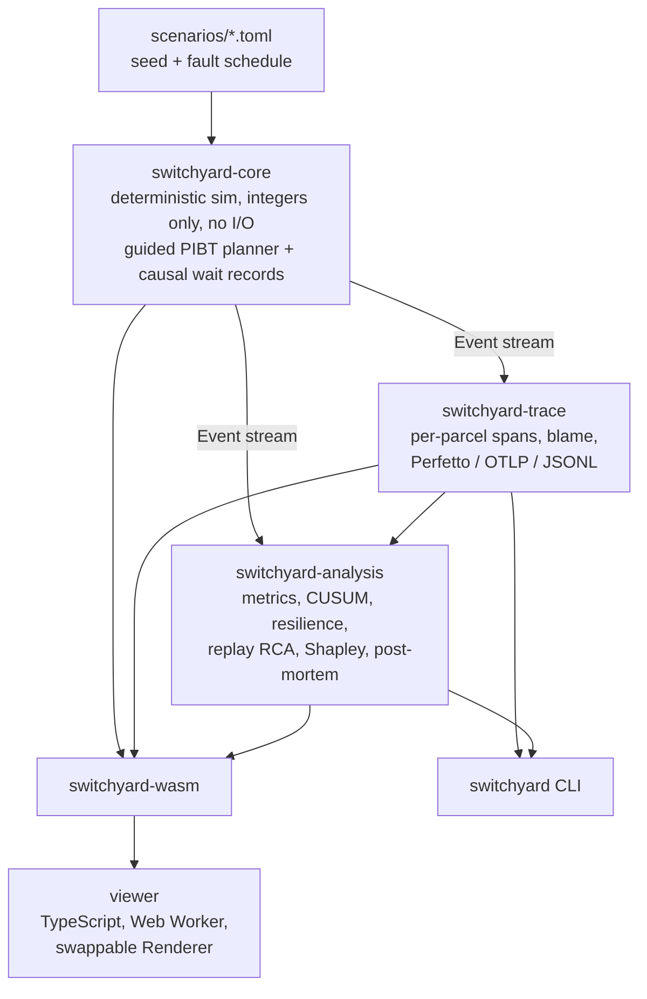

# Switchyard

**A sortation hub is a distributed system. Switchyard treats it like one:** it traces every parcel, breaks the floor on purpose, and writes the post-mortem for you, with each cause proven by replaying the shift without it.

<!-- HERO: demo GIF goes here (V1) -->
*The GIF will show the 60-second demo below: inject two dead robots and a chute jam, watch throughput dip, click a late parcel to see its blame chain, then read the generated post-mortem.*

## The 60-second story

A parcel carrier runs a hub with 200 robots moving about 6,000 parcels an hour. At 14:02 throughput drops by almost a third. The operations manager needs to know three things: what caused it, how much each cause cost, and what would have fixed it.

Today that answer is a meeting, a guess and a spreadsheet.

- Design-time simulators (FlexSim, Emulate3D, AnyLogic) tell you whether a layout will work before go-live. They don't explain Tuesday.
- Robot-developer tools (Formant, Foxglove) tell you what one robot is doing.
- Process mining shows that the process deviated, after the fact.

None of them answers "why did we lose 31 % at 14:02, and what is each cause worth?"

Switchyard is a deterministic twin of the sort floor with the observability stack of a software service built around it. The demo flow:

1. Open the viewer. A medium hub runs smoothly.
2. Inject chaos: two robots die in a central aisle, and a chute jams. The throughput chart dips.
3. Click a late parcel. Its trace shows where its time went and the chain of robots that blocked it, down to the root.
4. Run the post-mortem. It reads like: *"Throughput fell 31 % at 14:02. The failure in aisle 7 explains 78 % of the lost parcels (replay-verified); the C12 jam explains 19 %."*

<!-- Demo flow: docs/PRODUCT.md section 7. The figures in step 4 are the target output of the V1 demo, not yet produced by the engine. -->

## Why it is different

Software engineering already solved this problem. Distributed tracing finds where a request spent its time. Chaos engineering breaks production on purpose to learn how it fails. Blameless post-mortems turn an incident into a ranked list of causes. Switchyard moves all three onto a robot floor.

| In software | On the sort floor |
|---|---|
| Requests | Parcels |
| Servers | Robots |
| Queues | Induction stations, chutes |
| Lock waits | Robots blocking robots |
| Outages | Dead robots, blocked aisles, jammed chutes, surges |

**The strongest point: causes are proven, not estimated.** Production root-cause tools guess "what if this cause were absent" from correlations. The best learned-graph methods scored close to random in a 2024 benchmark ([ADR 0005](docs/adr/0005-counterfactual-replay-rca.md)). Switchyard's floor is deterministic: a run is a pure function of scenario, seed and fault schedule. So the post-mortem does not estimate. It re-runs the same shift with one cause removed and measures what came back.

**Blame chains alone miss most of the damage.** Switchyard walks the robot wait-for graph to name the root blocker of every delayed parcel. That works, but it only sees direct blocking. In our own chaos presets, with direct attribution working correctly, most of a fault's cost still showed up as congestion: robots yielding, stations backing up, fleets rerouting, far from the fault itself ([CP2 insight](docs/checkpoints/v1-cp2.md)). A blocking chain cannot see that. A replay captures the total effect, because it re-runs every consequence.

<!-- Source: docs/checkpoints/v1-cp2.md "Insight for the product story"; theory in docs/research/2026-10-20-postmortem-engine.md section 3.6. The blame-versus-replay gap chart is planned for V1; no figure is published yet. -->

## Try it

You need Rust (stable) and Node 22. Full setup, including Windows: [docs/DEVELOPMENT.md](docs/DEVELOPMENT.md).

```bash
# Simulate 2 h of the 200-robot medium hub (1 tick = 0.5 s, so 14400 ticks)
cargo run --release -p switchyard-cli -- run --scenario medium --ticks 14400

# Break it, and score the floor against its fault-free twin, over 5 seeds
cargo run --release -p switchyard-cli -- chaos \
  --scenario two-dead-robots-and-a-jam --ticks 14400 --seeds 1..5

# Or inject your own faults
cargo run --release -p switchyard-cli -- chaos --scenario medium --ticks 14400 \
  --fault "robot-failure:robot=31,at=30m,for=20m" \
  --fault "chute-jam:chute=12,at=30m,for=15m"

# Export per-parcel traces; open the result in https://ui.perfetto.dev
cargo run --release -p switchyard-cli -- export --scenario medium --ticks 14400 \
  --format perfetto --parcels late:p95 --out traces.json
```

Presets: `small`, `medium`, `large`, and the chaos presets `aisle-7-blocked`, `peak-surge`, `two-dead-robots-and-a-jam`. Fault kinds: `robot-failure`, `aisle-block`, `chute-jam`, `induction-outage`, `volume-surge`, `scanner-drift`. Export formats: Perfetto (Chrome trace JSON), OTLP JSON, JSONL.

```bash
# Automatic post-mortem (coming in V1)
cargo run --release -p switchyard-cli -- postmortem --scenario two-dead-robots-and-a-jam --ticks 14400
```

<!-- NUMBERS: paste the `run` output (throughput, per-robot rate, state hash) here at V1 -->
<!-- NUMBERS: paste the `chaos` resilience table (lost parcels, max dip, time to recover) here at V1 -->
<!-- NUMBERS: paste an excerpt of the generated post-mortem here at V1 -->

The viewer runs the same Rust core compiled to WebAssembly, in a browser worker:

```bash
cd viewer && npm install && npm run dev
# choose the hub with ?preset=small | medium | large, for example
# http://localhost:5173/?preset=medium
```

## How it works



**Planner and causal records.** Up to hundreds of robots are coordinated every tick by PIBT, a priority-inheritance planner from the multi-agent path finding literature, ported to Rust and steered by one-way-preferred lanes like city streets. Whenever a robot fails to make progress, the planner records why: blocked by a robot, yielded to one, a blocked cell, an unavailable chute, a busy station. Those records form a wait-for graph each tick; walking it gives the direct and the root cause of every delay. This is lock-wait attribution from databases, applied to robots. [ADR 0003](docs/adr/0003-guided-pibt-with-causal-records.md).

**Traces.** The core's only output is a typed event stream, so every consumer is a pure function of it. The trace builder turns it into one trace per parcel. Phase spans (queued, awaiting robot, loading, travelling, blocked, chute wait) tile the parcel's lifetime exactly, and each blocked span names its direct blocker and root cause. [ADR 0004](docs/adr/0004-event-stream-and-trace-model.md).

**Chaos and the twin.** The fault catalog covers robot failure, aisle block, chute jam, induction outage, volume surge and scanner drift. Every experiment runs next to a fault-free twin with the same seed, so the comparison carries no noise. Random draws are keyed per parcel, so a fault only changes the parcels it touches. The resilience score reports lost parcels, maximum dip, time to recover and graceful-degradation ratio, next to baseline utilisation.

**Post-mortem engine (CP3, in progress).** A one-sided CUSUM on the throughput deficit against the twin raises an incident. Active faults and the top blame hotspots become a shortlist of at most six candidates. Each is replayed with that cause removed and ranked by the share of lost parcels it recovers. Exact Shapley values over the candidates (at most 64 parallel replays) split the blame when causes interact, and whatever is left is reported as unexplained. The output follows the Google SRE post-mortem template, and every number cites the replay behind it. [ADR 0005](docs/adr/0005-counterfactual-replay-rca.md).

Language choice and the WASM split: [ADR 0001](docs/adr/0001-rust-core-wasm-viewer.md). Full design: [docs/ARCHITECTURE.md](docs/ARCHITECTURE.md).

## Engineering quality

- **Determinism contract** ([ADR 0002](docs/adr/0002-determinism-contract.md)). Integer-only sim state, no `HashMap` in the core (enforced by clippy), seeded ChaCha8 streams per concern, single-threaded sim, and a canonical state hash per run. CI runs the reference scenario on Linux, Windows and macOS and builds the `wasm32` target. Comparing the hash across all four is the stated V1 gate.
- **Tests.** <!-- NUMBERS: total test count at V1 --> The CP1 gate counted 66 Rust tests plus 13 viewer tests. <!-- docs/checkpoints/v1-cp1.md, re-verification --> Property tests (`proptest`) cover the invariants that matter: no collisions, parcels conserved, and trace spans that tile each parcel's lifetime.
- **Review.** Each checkpoint goes through an independent code review with experiments. The findings, including the critical ones, are published in [docs/checkpoints](docs/checkpoints/).
- **Performance.** Two hours of the 200-robot medium hub simulate in 0.39 s in a release build. The 500-robot large hub takes about 1 s. A chaos run of 10 two-hour simulations (faulted runs and twins) takes 0.85 s with rayon. <!-- docs/checkpoints/v1-cp1.md, v1-cp2.md; measured on the dev machine -->
- **Calibration.** Industry deployments run at roughly 25 to 50 parcels per robot per hour. The presets land inside that band: 38.7 (small, 40 robots), 31.4 (medium, 200) and 31.6 (large, 500). <!-- docs/checkpoints/v1-cp1.md -->

## Status and roadmap

**Now: V1 in progress.** V0 and checkpoint 1 (the floor and the planner) are done. Checkpoint 2 (traces, exporters, the fault catalog and the resilience score) is built and under review; its blame findings are being fixed. Checkpoint 3 (post-mortem engine and viewer features) is next. Current state: [docs/STATUS.md](docs/STATUS.md).

V1 explains the twin, not a real floor. It has no real-site integration, no robot kinematics, no learned models, and deliberately simple visuals.

Ideas for V2:
- A better renderer (PixiJS, WebGL or native Bevy) behind the existing `Renderer` interface.
- LaCAM as a stuck-recovery planner.
- Real-site integration: WES/WCS connectors and live telemetry.
- Parquet export.

## Repo map

| Path | What is there |
|---|---|
| `crates/core` | Deterministic sim, planner, faults, causality, scenario presets |
| `crates/trace` | Per-parcel traces, blame, exporters |
| `crates/analysis` | Metrics, resilience, CUSUM, replay RCA, post-mortem |
| `crates/cli` | The `switchyard` binary |
| `crates/wasm` | WebAssembly facade for the viewer |
| `viewer/` | TypeScript + Vite web app |
| `scenarios/` | Scenario presets and chaos presets (kept in sync with the core by a test) |
| `docs/` | [Product](docs/PRODUCT.md), [architecture](docs/ARCHITECTURE.md), [ADRs](docs/adr/), [research](docs/research/), [checkpoints](docs/checkpoints/), [development setup](docs/DEVELOPMENT.md) |

## Licence

[MIT](LICENSE).
